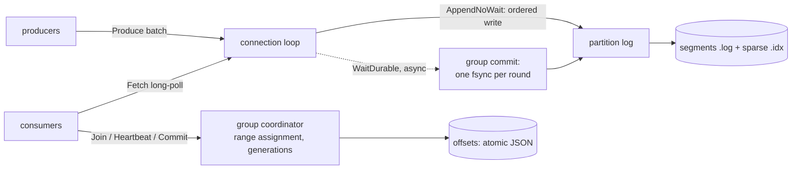

# riverlog

A Kafka-style persistent message log in Go. It has partitioned topics stored as CRC-checked segment files, crash recovery, group commit, long-poll fetches, consumer groups with generation fencing, and a pipelined binary protocol. With every acknowledged record fsynced to stable storage, a single producer reaches **2.17M records/s, 11.9x Kafka 4.4** on the same machine. Without fsync, Kafka is faster with 4 partitions (6.0M vs 4.4M records/s), and NATS JetStream has the lowest delivery latency.

[](https://github.com/eshaan2418/riverlog/actions/workflows/ci.yml)
[](LICENSE)


## Why this exists

A log broker is a small set of ideas that are easy to get subtly wrong:
- append-only segments and a recovery rule for torn writes;
- an fsync policy that the acknowledgement actually honours;
- not showing readers data that a crash could erase;
- consumer-group rebalances that never let two consumers own a partition at once.

riverlog implements those ideas compactly. It tests them by `SIGKILL`ing the real binary under load, and benchmarks against Kafka and NATS JetStream with matched durability settings. That includes the detail that matters on macOS: whether "fsync" means flushing the drive's cache.

## Highlights

- **Acknowledged means durable.** With `-sync always`, a produce is acked only after its batch is fsynced. Concurrent and pipelined appends share fsyncs (group commit), and consumers only see durable records. The crash test kills the broker 8 times under 4 concurrent producers, then checks every acknowledged record: 0 lost, 0 duplicated, and offsets gap-free. That holds over 81,133 acknowledged records with `F_FULLFSYNC` and 574,857 with plain `fsync`.
- **Crash recovery.** On restart, the active segment is rescanned and cut at the first torn, garbage or bit-flipped batch, which is checked by length, CRC-32C, record parse and offset continuity. The tests damage segments at random positions.
- **Pipelined protocol.** Responses carry correlation ids. A long-poll fetch never blocks a produce on the same connection, and one connection's batches stay in order while sharing fsyncs.
- **Consumer groups.** The broker assigns partitions by range. Rebalances run on join, leave and missed heartbeats, and offset commits are fenced by generation. Committed offsets are written atomically. A test churns four consumers while 30,000 records flow, and checks that every record is consumed and no generation has two owners for a partition.
- **Retention** by size or age, with segments rolling at a configurable size.

## Quick start

```sh
git clone https://github.com/eshaan2418/riverlog && cd riverlog
make build test        # bin/riverlog, bin/rlbench; unit + integration tests
make crash             # SIGKILL crash test
./bin/riverlog -dir data -create events:4 &
```

## Usage

```go
cn, _ := client.Dial("127.0.0.1:9192")
cn.CreateTopic("events", 4)

p, _ := client.NewProducer(cn, "events", client.ProducerConfig{Linger: time.Millisecond})
p.Produce([]byte("user-42"), []byte("clicked"), func(r client.Result) {
    // r.Partition, r.Offset once durable (or r.Err)
})
p.Flush()

c, _ := client.NewConsumer(cn, client.ConsumerConfig{Group: "billing", Member: "worker-1", Topics: []string{"events"}, FromStart: true})
for {
    recs, _ := c.Poll(time.Second)   // rebalances are handled inside Poll
    for _, r := range recs { /* r.Key, r.Value, r.Offset */ }
    c.Commit()
}
```

The server takes `-sync always|interval|never`, `-fsync full|plain` (macOS: `F_FULLFSYNC` or `fsync(2)`), `-segment-bytes`, `-retention-bytes` and `-retention-age`.

## Architecture



[docs/DESIGN.md](docs/DESIGN.md) covers the batch format, recovery rules, group commit, the rebalance protocol, and what the crash test does and does not prove.

## Benchmarks

**Setup:** Apple M5 Pro (18 cores), 48 GB, internal SSD, macOS 27.0.1. The comparison is against Kafka 4.4.0 (KRaft, single node, 2 GB heap) and NATS JetStream 2.15.2 (file storage, single node). Everything runs on one machine, and each server starts from an empty data directory. One tool, [`cmd/rlbench`](cmd/rlbench/main.go), drives all three with the same workload. For Kafka it uses franz-go, with `acks=all` and no compression or idempotence, and for NATS it uses nats.go with async publish. Throughput runs last 10 s, with at most 65,536 unacknowledged records per producer, so the ack latencies mostly measure that queue. Latency runs send at a fixed rate and measure the time from produce to consume. Figures are medians of 3 runs. Raw data: [`bench/results/bench.json`](bench/results/bench.json). Reproduce with `make bench`, which needs `brew install kafka nats-server`.

### Durable: every acknowledged record fsynced

On macOS all three systems flush the drive's cache here, with `F_FULLFSYNC`. riverlog does it through Go's `File.Sync`. Kafka uses a topic with `flush.messages=1`, and Java's `FileChannel.force` has issued `F_FULLFSYNC` on macOS since JDK 9 ([JDK-8080589](https://bugs.openjdk.org/browse/JDK-8080589)). NATS uses `sync_interval: always`. "riverlog, plain fsync" is an extra row: `fsync(2)` survives a process crash but not necessarily a power loss.

| Workload | riverlog | Kafka | NATS JetStream | riverlog, plain fsync |
|---|---:|---:|---:|---:|
| 1 producer, 1 partition, 100 B | **2,171,304/s** | 182,832/s | 292/s | 2,146,447/s |
| 4 producers, 4 partitions, 100 B | **1,000,169/s** | 266,140/s | 284/s | 4,648,156/s |
| 4 producers, 4 partitions, 1 KiB | **150,607/s** (154 MB/s) | 34,307/s | 262/s | 1,967,524/s |
| latency at 200 records/s, p50 / p99 | 4.75 / **7.72 ms** | 6.58 / 26.85 ms | **4.33** / 115.01 ms | 1.60 / 2.68 ms |

### Async: acknowledged when written to the OS

riverlog runs with `-sync never`, and Kafka and NATS with their defaults.

| Workload | riverlog | Kafka | NATS JetStream |
|---|---:|---:|---:|
| 1 producer, 1 partition, 100 B | **2,076,122/s** | 684,159/s | 186,734/s |
| 4 producers, 4 partitions, 100 B | 4,433,605/s | **6,027,777/s** | 183,128/s |
| 4 producers, 4 partitions, 1 KiB | **793,461/s** | 461,475/s | 150,712/s |
| latency at 10k records/s, p50 / p99 | 1.65 / 4.41 ms | 1.19 / 6.89 ms | **0.09 / 2.09 ms** |

**What the numbers say:**

- **Group commit is the durable-mode story.** A drive-cache flush on this SSD takes milliseconds. riverlog pays one per round for all waiting batches, while Kafka with `flush.messages=1` flushes for each produce request, and NATS with `sync_interval: always` flushes for each message. Hence 11.9x Kafka with one producer, and NATS at a few hundred messages per second.
- **More partitions are slower under `F_FULLFSYNC`.** Each partition is a separate file needing its own flush, and flushes to one device serialize. Going from 1 to 4 partitions drops riverlog from 2.17M to 1.0M records/s. With plain `fsync` the same change scales to 4.6M.
- **Kafka is faster with 4 partitions when nothing is fsynced** (6.0M vs 4.4M records/s). Its producer and broker are heavily optimized for this case. riverlog wins with one partition (3x) and with 1 KiB records (1.7x).
- **NATS JetStream has the lowest delivery latency** in async mode (0.09 ms p50): it pushes messages to consumers instead of being polled. Its throughput is limited by per-message publishing, since the client does not batch.
- **An unexplained result:** riverlog's async 1 KiB run (793k/s) is slower than the same workload with plain fsync (1.97M/s). The likely cause is the OS throttling writers once too many dirty pages accumulate, which the periodic fsyncs avoid. I have not confirmed it.

These are single-machine numbers. Kafka is built to replicate, and none of the three replicated here.

## Design decisions and trade-offs

- **One batch format for disk and wire.** Fetches return stored bytes as they are, with no re-encoding, and the CRC is checked end to end by the client. The CRC deliberately excludes the base offset, so the broker can assign offsets without rehashing.
- **Readers see only durable data under `-sync always`.** Otherwise a consumer could act on a record that a crash later erases. That record's producer was never told it succeeded.
- **Index files are derived.** They are rebuilt from the log on open, so a crash can't leave the index ahead of the log.
- **Broker-side assignment.** Kafka has a group leader compute assignments. riverlog's coordinator does it itself, with one round trip and no assignment-sync protocol, at the cost of pluggable assignors.
- **Not built:** replication, idempotent producers and transactions, compression, compacted topics, and `sendfile` fetches.

## Testing

| Test | What it checks |
|---|---|
| `internal/log` | every offset reads back across segment rolls, for all three sync policies; reopen continues offsets; recovery from 60 random truncations, garbage tails and bit flips; batch bit flips detected; 16 concurrent writers get unique contiguous offsets with per-writer order kept; retention; long-poll wakeups |
| `tests/broker_test.go` | 20,000 keyed records over TCP, with per-key order and acknowledged offsets verified; long-poll latency; restart keeps data and committed offsets; consumer-group churn (no lost records, no double ownership per generation) |
| `tests/crash_test.go` | SIGKILL under load, 8 rounds, under both fsync modes: no acknowledged record lost, misplaced or duplicated |
| CI | `go vet`, `gofmt`, all tests with `-race`, and the crash test, on Linux and macOS |

## Limitations and roadmap

- Single node, with no replication.
- Delivery is at-least-once. A retried produce can duplicate, and records after the last commit are redelivered after a rebalance.
- The crash test covers process crashes. Power-loss durability depends on `-fsync full` and the drive honouring flushes.
- Roadmap: leader-follower replication with an ISR-style acknowledgement, idempotent producers (producer id + sequence), and `sendfile` fetches.

## Project structure

```
internal/log/        batches, segments, index, recovery, group commit, retention
internal/wire/       framing and encoding
internal/broker/     TCP server, topics, consumer-group coordinator
client/              pipelined connection, batching producer, group consumer
cmd/riverlog/        broker binary
cmd/rlbench/         benchmark driver for riverlog, Kafka and NATS
tests/               integration and crash tests
scripts/bench.py     runs all three systems -> bench/results/bench.json
```

## License

MIT. See [LICENSE](LICENSE).
